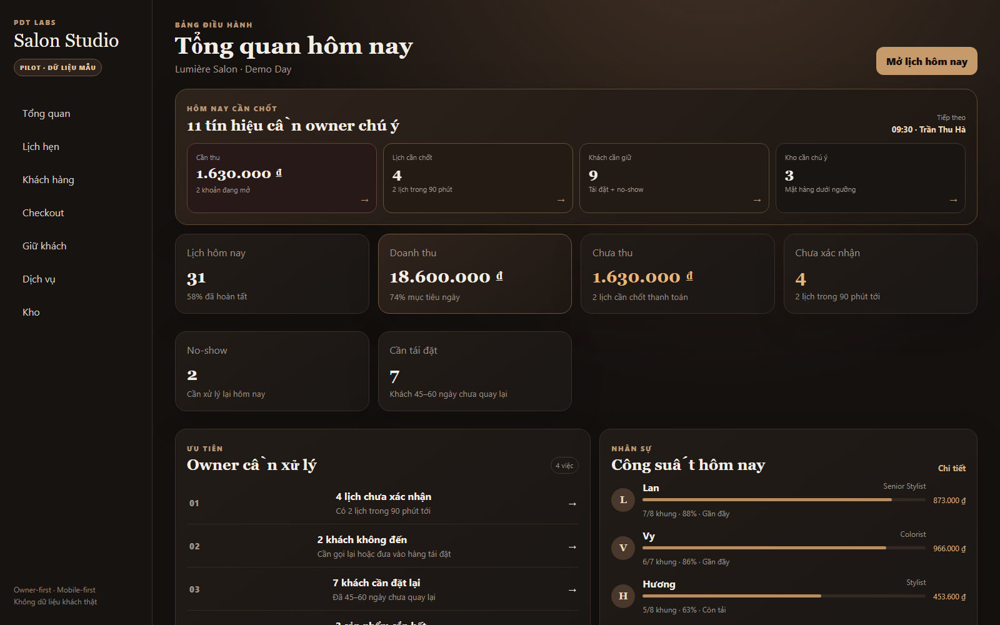
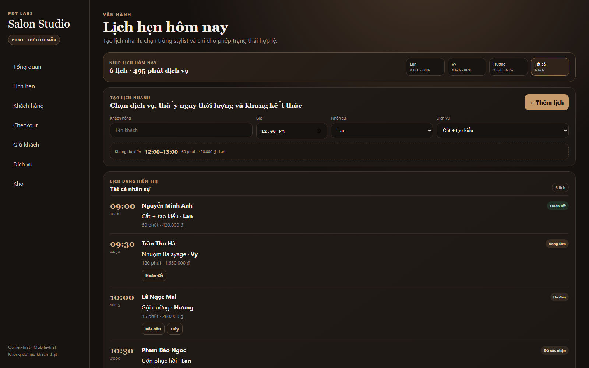
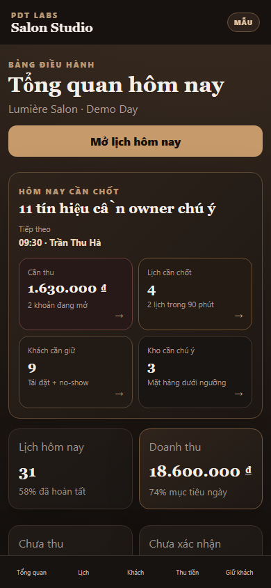

# PDT Salon Studio — Business Dashboard Demo

**A responsive, owner-first salon operations prototype built with Next.js, React and TypeScript.**

> **Portfolio disclosure:** This is a self-initiated PDT LABS demonstration project. All customer, employee, booking, inventory and financial records in the app are **synthetic sample data**. No client commissioned this showcase, and it does not represent a production deployment or validated business results.

## What it demonstrates

- **Owner dashboard:** daily priorities, appointment activity, projected amounts and alerts
- **Appointments:** booking calendar, status handling and schedule-oriented UI
- **Customer view:** customer lists and relationship information using example records
- **Checkout:** a demo payment workflow and status presentation
- **Service operations:** service catalogue and staffing context
- **Inventory:** low-stock identification and sample products
- **Retention:** a sample contact queue and rebooking workflow
- **Responsive UI:** desktop sidebar and compact mobile navigation

This showcase is a **curated, reviewable copy derived from the team's private PDT LABS Salon Business OS work**. The original private repository remains separate and unchanged.

## Preview



| Appointments | Mobile |
| --- | --- |
|  |  |

The screenshots above are **captured from a locally running demo**, not generated marketing mockups.

## Run locally

Requires Node.js 20+.

```bash
npm install
npm run dev
```

Open [http://localhost:3000](http://localhost:3000).

## Verification

```bash
npm run typecheck
npm run test:core
npm run build
```

The repository contains unit tests for the local booking, checkout, journey and retention logic, and browser-oriented E2E test specifications. See `tests/` for actual coverage. Passing static or unit tests **does not** constitute production readiness.

## Stack

- Next.js App Router, React, TypeScript
- CSS modules and responsive layouts
- Local deterministic JavaScript business rules
- Node.js test runner; Playwright test specifications

## Boundaries

**Included:** UI shell, example data, deterministic local business rules, relevant tests.

**Not included:** customer databases, OAuth credentials, payment gateways, live SMS/email, production authentication, server-side real-data persistence, external API keys or confidential PDT infrastructure.

No claims of real revenue, appointments, users or adoption are made.

## Suggested service use

This demonstration illustrates the kinds of client deliverables PDT LABS can prepare for a defined engagement: responsive business dashboards, workflow prototyping, data presentation, validation logic and QA-ready handoff packages.

**For a real business implementation:** requirements, authentication, permissions, privacy, database design, integration contracts, security testing and production deployment must be scoped and implemented separately.

## Rights and attribution

The demo is published by its repository owner, PDT LABS. It was prepared from the team's own private prototype; third-party runtime dependencies retain their respective upstream licenses. No license granting reuse of the project source is provided at this stage. Refer to dependency licenses before redistribution.

---

**PDT LABS · Portfolio sample · Demo only · No live client data**
